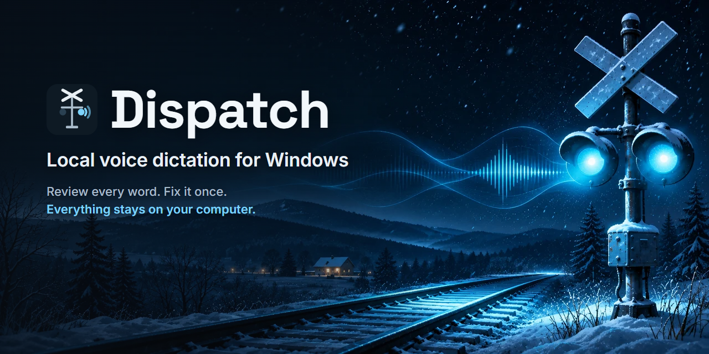
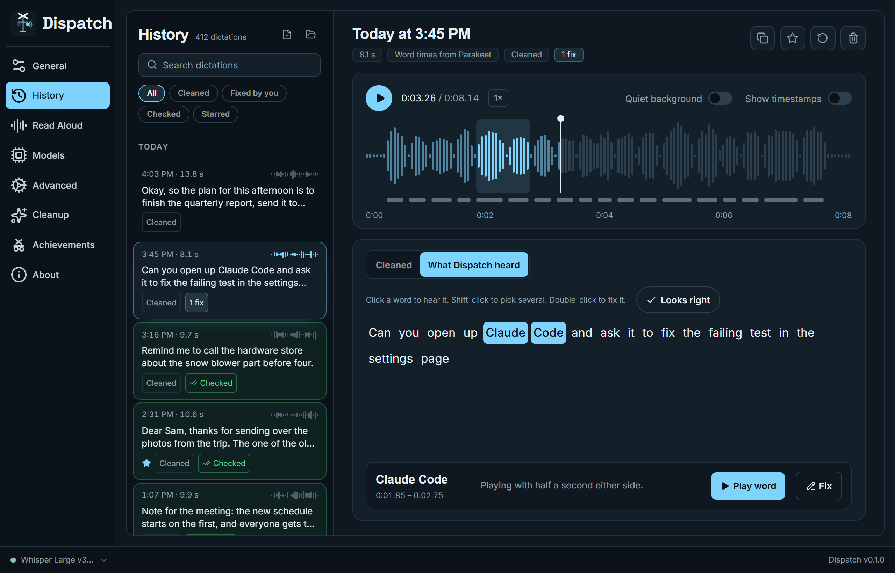
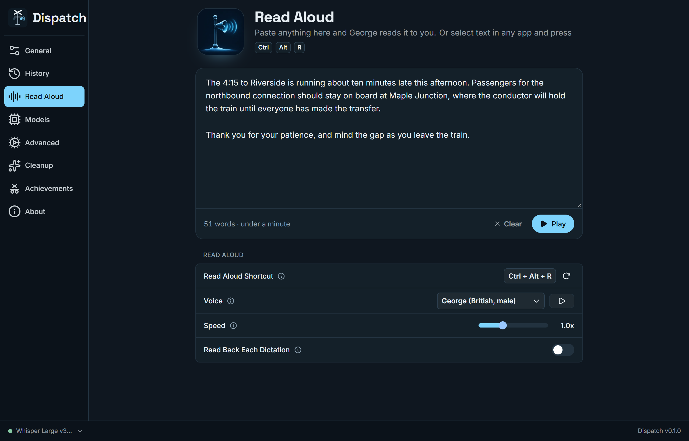
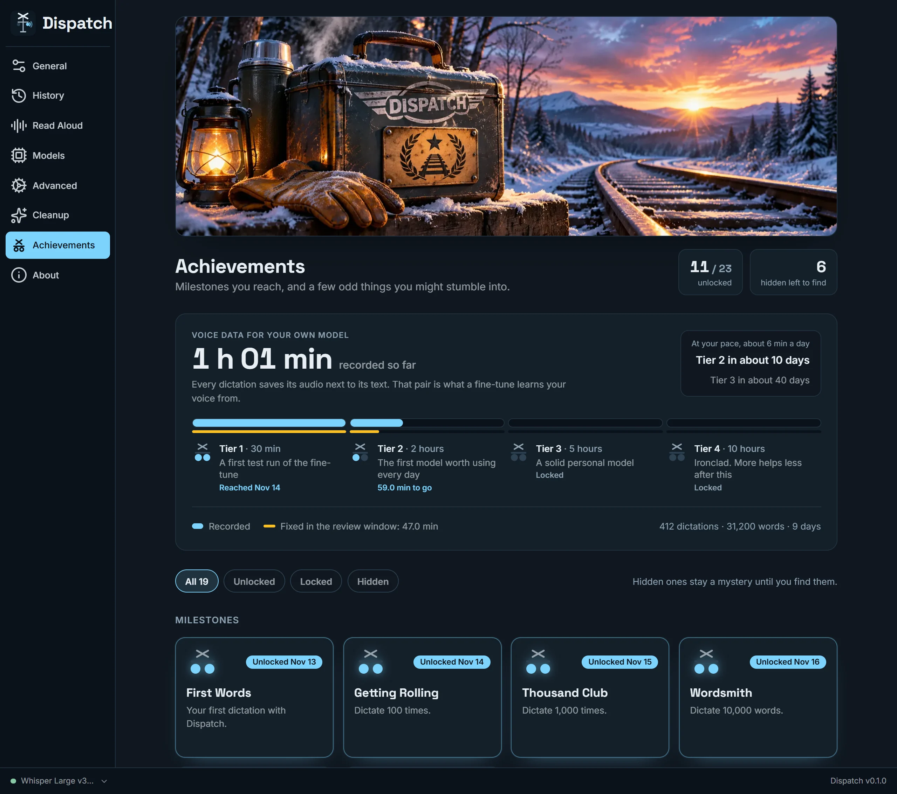

<!--
  Dispatch's README. In the private repo this file sits beside Handy's
  README.md, so upstream merges stay clean; the public snapshot publishes it
  as README.md (HANDOFF.md, "Going public"). The images in docs/dispatch/
  are the real interface on made-up demo data: re-render them with
  scripts/dispatch/demo-shots.mjs.
-->



# Dispatch

**Local voice dictation for Windows. Press a key, speak, and your words appear wherever you're typing. Then review what it heard, fix its mistakes, and teach it your words.**

Dispatch runs entirely on your computer. Your voice, your recordings and your text never leave it.

Dispatch is a fork of [Handy](https://github.com/cjpais/Handy) by [CJ Pais](https://github.com/cjpais), a free and open source speech-to-text app. Handy does the hard part: recording, speech recognition with Whisper and Parakeet, and pasting into any app. Dispatch builds on it with a review window for your dictations, a Fix-It List, optional AI cleanup, read aloud, and a railroad look. If you want a simpler, cross-platform tool, use Handy.



## What it does

- **Dictate anywhere.** Hold or tap a shortcut (Ctrl+Space by default), speak, and the text is pasted into the app you're using. Speech is recognized on your computer with Whisper or Parakeet.
- **Review every dictation.** History shows each one with its waveform. Click any word to hear exactly what you said there, compare the cleaned text with what Dispatch heard, and fix mistakes word by word. Mark a dictation "Looks right" when there's nothing to fix. A "Quiet background" switch takes the room noise out of playback.
- **Fix it once.** Tick "Fix this every time" when fixing a word, and Dispatch adds the correction to your Fix-It List, so the same mishearing is fixed automatically from then on. Custom words teach it how to spell names and jargon.
- **Optional AI cleanup.** A small language model running on your computer (through [Ollama](https://ollama.com)) removes filler words, fixes punctuation, and keeps only your correction when you change your mind mid-sentence. Every cleanup is checked in code: if a name you said goes missing, Dispatch pastes what it heard instead. If cleanup isn't available, you get exactly what you said.
- **Read aloud.** Select text in any app and press Ctrl+Alt+R, and George reads it to you in a natural voice ([Kokoro](https://huggingface.co/hexgrad/Kokoro-82M), also running locally). Or paste text into the Read Aloud page, where you can also pick another voice and speed.
- **Achievements.** Milestones, habits and a few hidden surprises as you use it.
- **A railroad theme.** Crossing-signal artwork and subtle steam sounds when recording starts and stops. Handy's original sounds are one click away in Settings.

| Read aloud                                                                               | Achievements                                                                                                           |
| ---------------------------------------------------------------------------------------- | ---------------------------------------------------------------------------------------------------------------------- |
|  |  |

<sub>Screenshots show made-up demo dictations, not anyone's real ones.</sub>

## Install

Dispatch is for **Windows 10 and 11 (64-bit)**.

1. Download `Dispatch_x.y.z_x64-setup.exe` from the [latest release](../../releases/latest).
2. Run it. The installer isn't code-signed yet, so Windows SmartScreen will warn you: click **More info**, then **Run anyway**.
3. Dispatch opens and walks you through downloading a speech model.
4. Press **Ctrl+Space** and start talking.

Dispatch lives in the system tray. Closing its window keeps it running; quit from the tray icon.

### Which speech model?

- **Parakeet** (recommended for most people): fast and accurate, and runs well even without a graphics card.
- **Whisper Large v3 Turbo**: worth trying if you have a capable graphics card, or if Parakeet struggles with your accent. It uses your GPU through Vulkan.

You can download several and switch any time in Settings. Your recordings and fixes don't depend on the model, so switching never loses anything.

### AI cleanup (optional)

Cleanup needs [Ollama](https://ollama.com) running on your computer with the `qwen3.5:4b` model:

1. Install Ollama from [ollama.com](https://ollama.com).
2. In a terminal, run `ollama pull qwen3.5:4b` (a few GB).

Dispatch finds Ollama at its usual address (`http://localhost:11434`). With a decent graphics card, cleanup adds well under a second once the model is loaded. The model and prompt can be changed in Settings.

Until Ollama and the model are found, cleanup stays off and **Settings > General** shows these steps with a **Check again** button; Dispatch also checks each time it starts, and switches cleanup on once they're there. Without cleanup, Dispatch pastes what it heard, with your Fix-It List applied.

## Privacy

Everything happens on your computer. Dispatch has no account, no telemetry and no automatic updates. It goes online only when you ask it to download something: a speech model (from Hugging Face, with Handy's mirror as a fallback) or George's voice (about 340 MB, from Hugging Face). AI cleanup talks only to Ollama on your own machine, unless you choose an online provider for it in Settings yourself.

Your dictations, recordings and fixes are stored in `%APPDATA%\com.ironfrostlabs.dispatch`. By default Dispatch keeps every recording, so they can be used to train a model on your voice later. You can choose to keep only the newest 10 instead; older recordings go to the Recycle Bin, never straight to deletion.

## Coming next: training on your voice

Every dictation keeps its audio next to its text, and the ones you fix or mark "Looks right" in History become checked pairs: exactly what's needed to fine-tune a speech model on your voice. Dispatch collects these from day one, on your computer only. A separate, optional training kit, with an "Export my voice data" button, is being worked on now. Training needs a capable graphics card, so it will always be optional.

## Build from source

Dispatch builds like Handy: install [Rust](https://rustup.rs) and [Bun](https://bun.sh), then:

```bash
bun install
bun run tauri dev     # run in development
bun run tauri build   # build the installer
```

See [BUILD.md](BUILD.md) for the details, including the voice activity model the build needs.

## How it was made

Dispatch was built by Joshua Russell (Iron Frost Labs) with [Claude Code](https://claude.com/claude-code), Anthropic's AI coding tool. Joshua directed the design, tested every change on his own voice, and made the calls; Claude Code wrote most of the code.

## Credits and license

- [Handy](https://github.com/cjpais/Handy) by CJ Pais and its contributors, the foundation of everything here.
- [Kokoro](https://huggingface.co/hexgrad/Kokoro-82M) for George's voice, run through [loqui](https://crates.io/crates/loqui-kokoro).
- [RNNoise](https://github.com/xiph/rnnoise), through [nnnoiseless](https://github.com/jneem/nnnoiseless), for the Quiet background switch.

Dispatch is released under the [MIT License](LICENSE). The railroad sound effects are the exception: they were generated with ElevenLabs and aren't MIT-licensed. [NOTICE.md](NOTICE.md) has the details and every third-party license.
